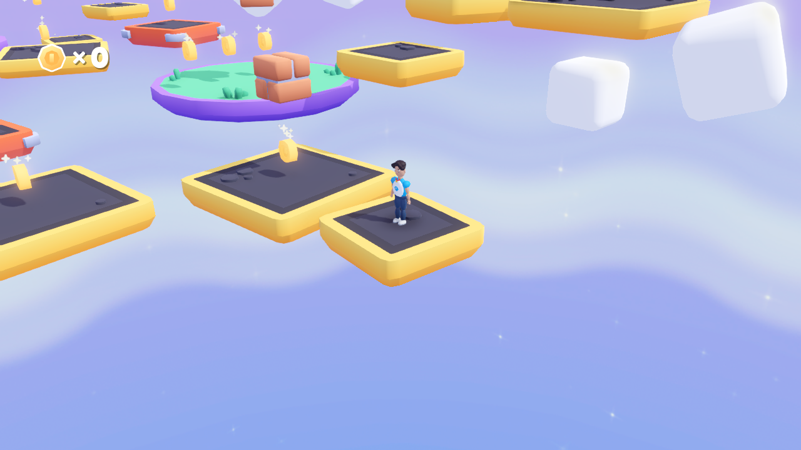

# Portrait 3D Platformer

A Godot 3D platformer featuring a custom stylized portrait character created in Blender.

## Play

[Play in your browser](https://pekza007.github.io/portrait-3d-platformer/) | [Download project ZIP](https://github.com/PEKZA007/portrait-3d-platformer/archive/refs/heads/main.zip)

## Controls

- **W A S D**: move
- **Space**: jump / double jump
- **Arrow keys**: rotate the camera
- **+ / -**: zoom

Click the game first to focus keyboard input. A desktop browser with WebGL 2 is recommended.

## Open the project

Download the ZIP, extract it, and import `project.godot` in Godot 4.7.2.
Press F5 to run. To export again, install matching export templates and use the Web preset.
The Web export uses Compatibility rendering and single-threaded execution.

## Character

- `models/portrait_character.glb`: game-ready model with idle, walk and jump clips
- `objects/portrait_character.tscn`: adapter for the starter kit player
- `scripts/portrait_character.gd`: animation adapter
- `art_source/portrait_character.blend`: editable Blender source (T pose and greeting)
- `art_source/game_animations.py`: script used to generate the three gameplay clips

The portrait character uses a basic segmented rig and original procedural animation.
Mixamo animations and MeleeLib/ShooterLib have not yet been integrated.

## Credits

Based on **Starter Kit 3D Platformer** by **Kenney**, under the MIT license.
The original license is preserved in `LICENSE.md`.
Custom portrait model and integration were created for this student project.
